# EduDigiClass LMS — Comprehensive Enterprise User Manual

**Platform:** EduDigiClass Learning Management Platform (ASP.NET Core .NET 10.0)  
**Host Target:** `http://20.193.144.80:82`  
**Database:** Microsoft SQL Server (`LMS-EduDigi`)  
**Standard:** UGC 4-Quadrant Framework, CBCS 10-Point Letter Grading, Gemini AI Evaluation  
**Audience:** Super Administrators, Faculty / Teachers, Student Learners  
**Document Code:** `ED-LMS-MANUAL-2026-V1`

---

## Executive Summary & Architecture

EduDigiClass is an enterprise learning management system designed for universities and higher-education institutions. It unifies:
1. **Academic Program & Curriculum Master** (Degrees, Semesters, Modular Subjects, Credits)
2. **Virtual Classroom** with integrated 1-click Zoom scheduling
3. **UGC 4-Quadrant E-Learning Framework** (Video, E-Text, Self-Assessment, Discussion)
4. **AI-Powered Question Bank & Paper Generator** (Google Gemini integration with Bloom's Taxonomy)
5. **AI Descriptive Answer Evaluation** (50% conceptual benchmark threshold, natural scoring ceiling)
6. **Statutory UGC 10-Point CBCS Grading Engine** with Grace Marks & Compartmental exam creation
7. **Login-Based Automatic Attendance Telemetry** (Real-time tracking, 75% statutory compliance)
8. **Bilingual Localization** (English & Urdu) with real-time Right-to-Left (RTL) rendering

---

## System Access & Default Credentials

| Portal Role | URL Endpoint | Default Email | Default Password | Privileges |
| :--- | :--- | :--- | :--- | :--- |
| **Super Admin** | `http://20.193.144.80:82/Admin/User` | `admin@TMS.com` | `Admin@123` | Institutional governance, bulk upload, policies |
| **Faculty / Teacher** | `http://20.193.144.80:82/InternalAssessment/FacultyDashboard` | `faculty@edudigi.com` | `Faculty@123` | Course delivery, Zoom live classes, AI grading |
| **Student Learner** | `http://20.193.144.80:82/MyCourses` | `student@edudigi.com` | `Student@123` | 4-Quadrant content, live classes, exams, grade card |

---

## CHAPTER 1: Authentication Gateway & Bilingual RTL

### 1.1 Online Learning Platform Gateway & Role Selector
The gateway provides dedicated login entry points for each university stakeholder:
- **Student Login**: Direct entry to `/Auth/Login` for courses, attendance, and exam taking.
- **Faculty Login**: Secure entry to the Faculty Command Center.
- **Administrative Login**: University administrative management panel.
- **Bilingual Toggle**: Toggle between English and Urdu with automatic RTL layout transformation.
- **Get App**: Direct downloads for iOS and Android mobile learning apps.

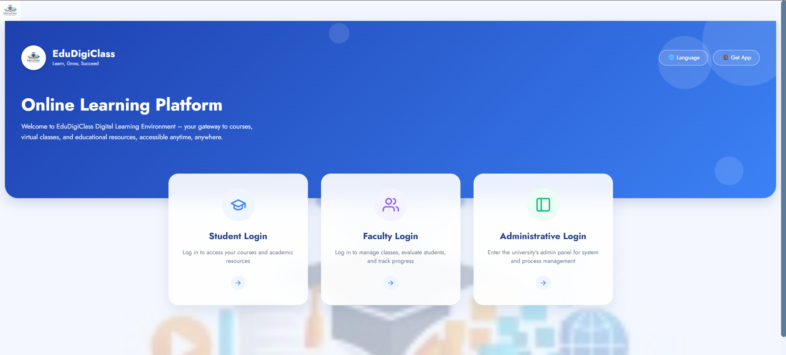

---

## CHAPTER 2: Super Admin Operations Manual

### 2.1 Institutional Command Dashboard
The Super Admin dashboard monitors total platform metrics, active courses, enrolled students, certified instructors, and system health.
- **Universal Search (`Ctrl + K`)**: Instantly search courses, syllabi, quizzes, faculty, and students.
- **RBAC Matrix**: Enforce granular role privileges.

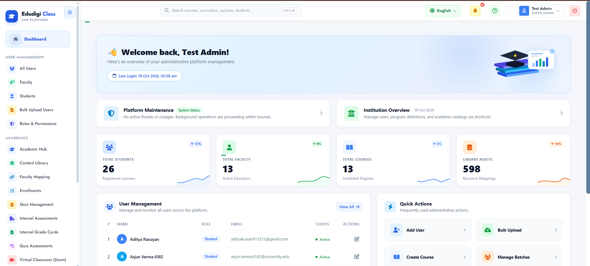

### 2.2 User Directory & Governance
The user table enables administrators to audit, search, filter, edit, and reset passwords for any account.
- **Role Badges**: Identifies account types (`Faculty (Active)`, `Student`, `Super Admin`).
- **Pagination & Filters**: Search across thousands of entries with sub-second response times.

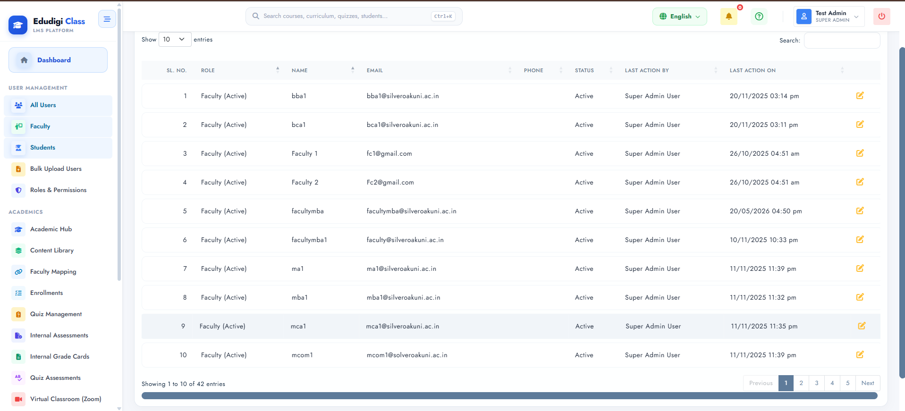

### 2.3 Bulk User Onboarding Center (CSV / Excel)
Facilitates batch creation of hundreds of user accounts simultaneously:
1. **Download Template**: Retrieve standard CSV/Excel format with mandatory fields (`Name`, `Email`, `Phone`, `Role`, `Password`).
2. **Upload Data**: Drag & drop `.csv`, `.xlsx`, or `.xls` files.
3. **Preview & Validate**: Server-side validation detects format errors and existing duplicates.
4. **Execution & Confirmation**: Creates accounts and sets **Force Password Change on First Login**.

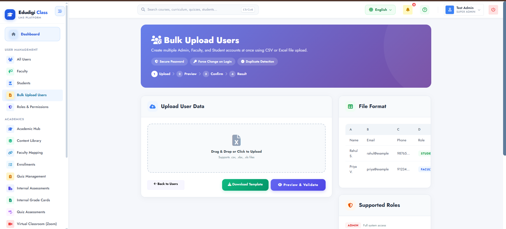

### 2.4 Academic Hub & Program Hierarchy
Author and organize degree programs, course catalogs, and syllabus structures:
- **Active Programs**: Bachelor of Business Administration (BBA - 6 Semesters, 5 Courses, 57 Content Items), Bachelor of Computer Applications (BCA - 6 Semesters, 6 Courses).
- **Curriculum Hierarchy Tree View**: Visual tree mapping Programs -> Semesters -> Courses -> Units -> Topics.

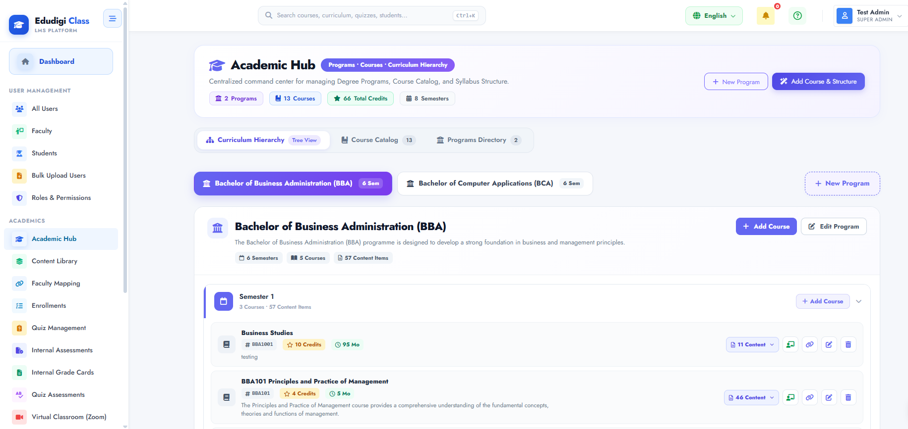

### 2.5 Global Content Center (Content Library)
Centralized repository following the "Upload once, assign anywhere" model:
- Supports PDF textbooks, video lectures, PPT presentations, and syllabus documents.
- Automatic binary signature inspection prevents corrupted or malicious uploads.

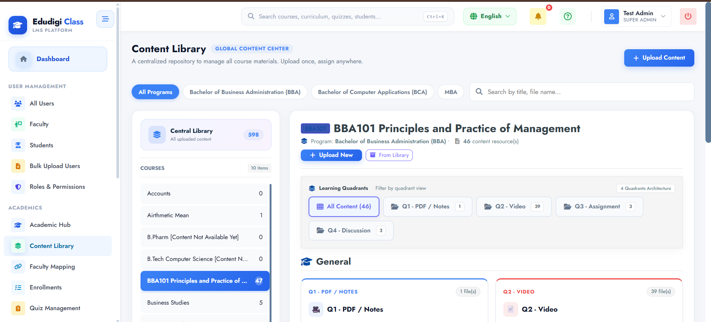

### 2.6 Academic Enrollment Center
Assign and audit student enrollments across academic degree programs and individual modular courses. Enrolled learners immediately receive access to their assigned curriculum.

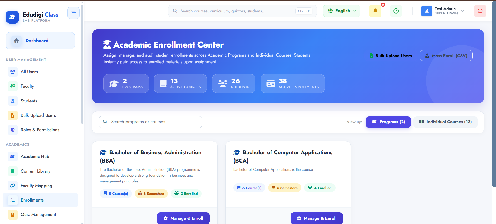

### 2.7 All Student Grade Cards & Evaluation Ledger
Institutional grade repository displaying semester-wise grade distributions, published assessment marks, and UGC 10-point scale grades.

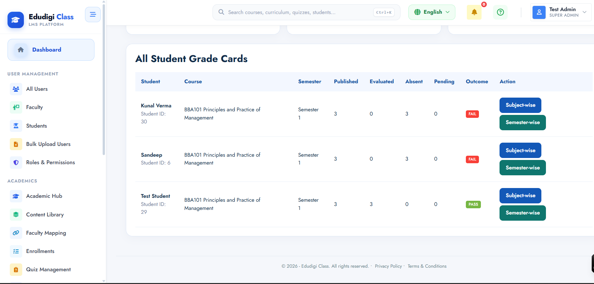

---

## CHAPTER 3: Faculty Operations Manual

### 3.1 Faculty Teaching Command Desk
Faculty view assigned courses, active learners, upcoming Zoom lectures, and submissions awaiting evaluation.

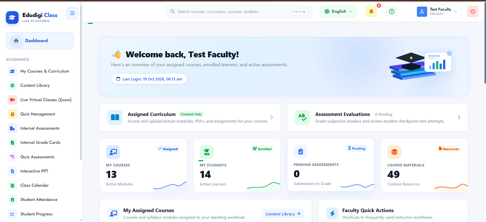

### 3.2 Assigned Courses & Syllabus Management
Inspect assigned subject modules, learning outcomes, credit weightages, and topic structures.

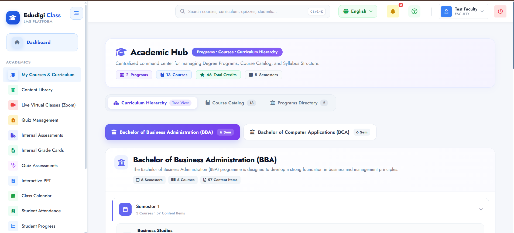

### 3.3 Virtual Classroom & Live Zoom Session Scheduling
Schedule live interactive lectures without leaving the LMS:
1. Click **Schedule Zoom Class**.
2. Select course, define topic title, date, time, and duration.
3. System provisions a secure Zoom meeting room and adds a 1-click **Join Class** button to every enrolled student's calendar.

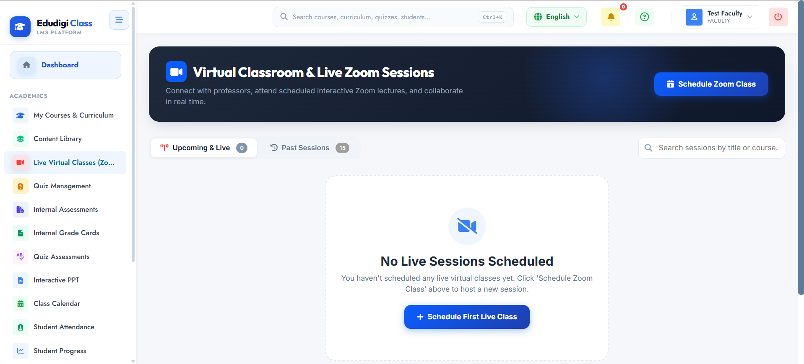

### 3.4 AI Question Bank & Automatic Question Paper Generator
- **Gemini AI Suggested Questions**: Generate MCQs and descriptive questions mapped to Bloom's Taxonomy (Remember, Understand, Apply, Analyze, Evaluate, Create).
- **1-Click Blueprint Assembly**: Auto-assemble formal question papers with sections (Section A: MCQs, Section B: Short Notes, Section C: Long Problems) and print institutional hardcopies.

### 3.5 Internal Assessment Policy & Authoring
Create assessments linked to university-approved windows:
- **Assessment Types**: Multi-select combinations of `Assignment`, `Written`, `Practical`, `Project`, `Presentation`, `Viva`, and `MCQ`.
- **Submission Rules**: Configure maximum marks, due dates, and allow late submissions.

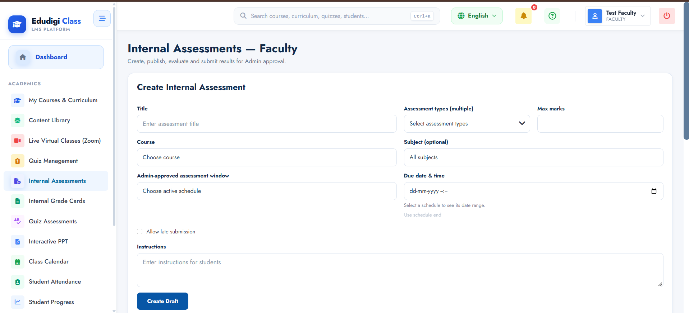

### 3.6 Assessment Drafting & Gemini AI Evaluation
- Configure marking rubrics and expected answers for descriptive questions.
- **Gemini AI Evaluation**: Automatically analyzes conceptual match depth.
- **50% Conceptual Threshold**: Flags answers meeting core concepts; triggers review if below.
- **Natural Marks Ceiling**: Prevents unrealistic 100% scores on subjective essays, utilizing quarter-mark increments (.00, .25, .50, .75).

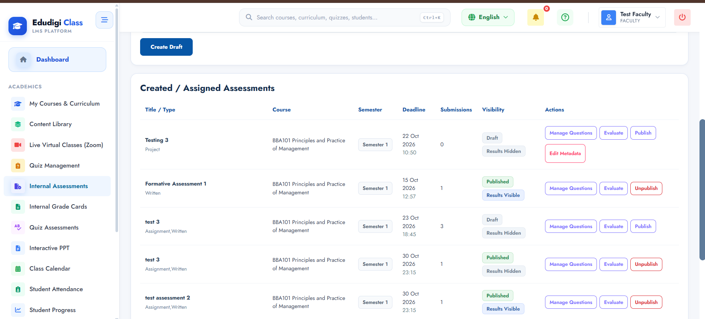

### 3.7 Student Progress & Learning Analytics Hub
Track video lecture watch time percentages, reading completion, and quiz scores, with proactive flags for at-risk learners.

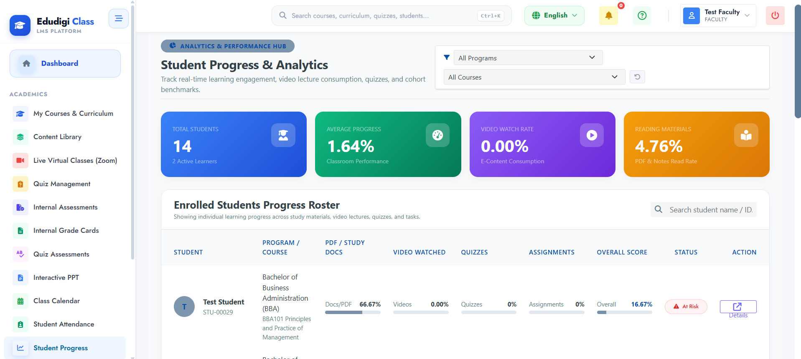

---

## CHAPTER 4: Student Learning Manual

### 4.1 Student Portal Dashboard
Personalized learning desk displaying enrolled courses, daily class schedules, attendance percentage, and academic certificates.

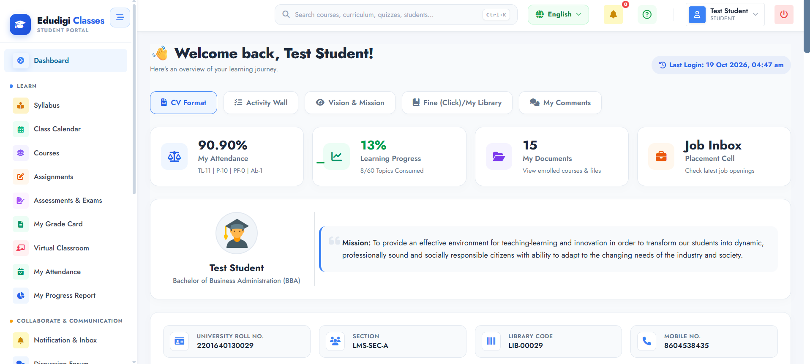

### 4.2 Classroom Schedule & Live Zoom Sessions
Interactive calendar with Month, Week, and Day views displaying upcoming classes and direct 1-click **Join Class** triggers.

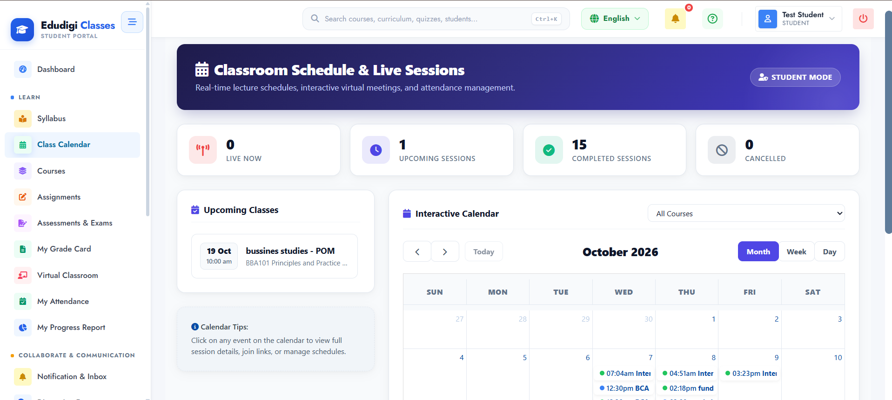

### 4.3 My Courses & UGC 4-Quadrant Multimedia Hub
Subjects are delivered in four statutory quadrants:
- **Quadrant 1 (Video)**: High-definition video lectures with watch time telemetry.
- **Quadrant 2 (Reading)**: Downloadable PDF textbooks and lecture notes.
- **Quadrant 3 (Self-Assessment)**: Practice quizzes and self-check tests.
- **Quadrant 4 (Discussion)**: Doubt-clearing forums and instructor interaction.

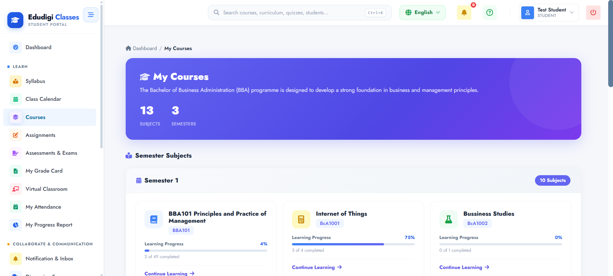

### 4.4 Assessments & Quizzes Taking Center
Complete timed topic quizzes and formal examinations within a secure browser window with automated draft preservation.

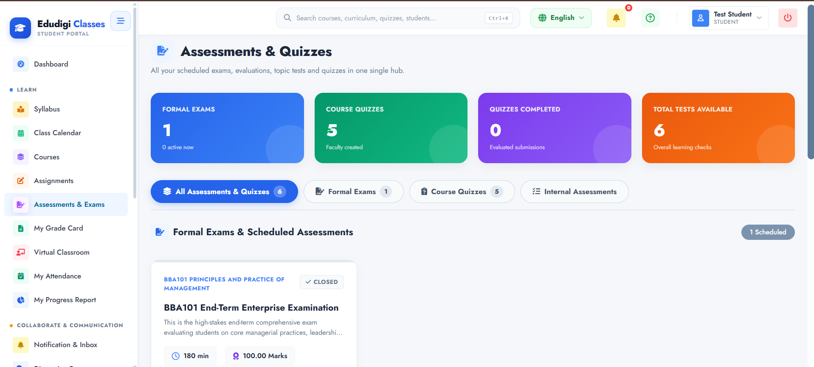

### 4.5 Login-Based Automatic Attendance Telemetry
In addition to lecture attendance, the platform records presence automatically upon user login:
- Displays **Current Attendance Rate** (e.g. **90.9%**).
- Tracks Total Days Tracked, Days Present, Late Arrivals, and Absences.

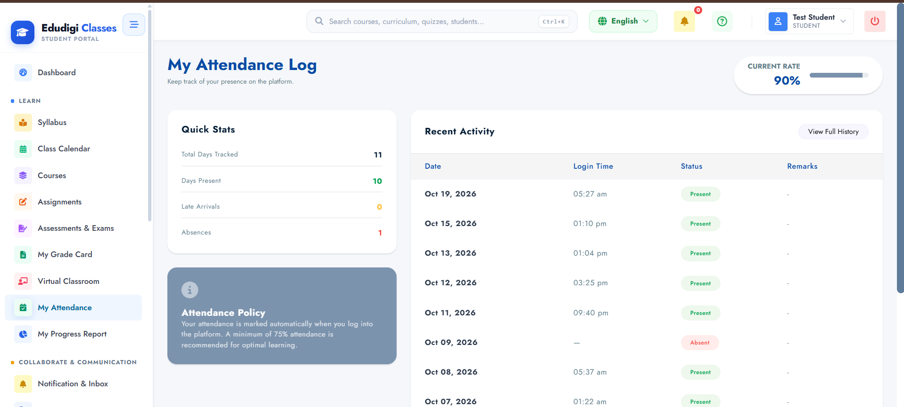

### 4.6 Student Progress Report & Grade Card Download
Comprehensive telemetry report and 1-click printable A4 semester grade card.

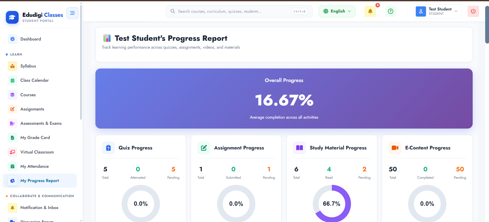

---

## CHAPTER 5: Institutional Reference & Appendix

### 5.1 UGC Standard 10-Point CBCS Grading Scale

| Percentage Cutoff | Letter Grade | Grade Point | Classification | Result Status |
| :---: | :---: | :---: | :--- | :--- |
| **≥ 90.00%** | **O** | **10.0** | Outstanding | Distinction |
| **80.00% – 89.99%** | **A+** | **9.0** | Excellent | Cleared |
| **70.00% – 79.99%** | **A** | **8.0** | Very Good | Cleared |
| **60.00% – 69.99%** | **B+** | **7.0** | Good | Cleared |
| **50.00% – 59.99%** | **B** | **6.0** | Above Average | Cleared |
| **40.00% – 49.99%** | **C** | **5.0** | Average | Cleared |
| **33.00% – 39.99%** | **P** | **4.0** | Pass | Marginal Pass |
| **< 33.00%** | **F** | **0.0** | Fail | Compartmental Re-assessment |

### 5.2 Grace Marks & Compartmental Examination Engine
- **Grace Marks**: Discretionary grace marks (1–5 marks) automatically applied to borderline students per policy.
- **Compartmental Exams**: 1-click automated cloning of assessments into supplementary re-assessments (`AttemptNumber = 2`, `IsCompartmental = true`).

---
*© 2026 Vagmine Pro Techno Pvt. Ltd. All rights reserved.*
